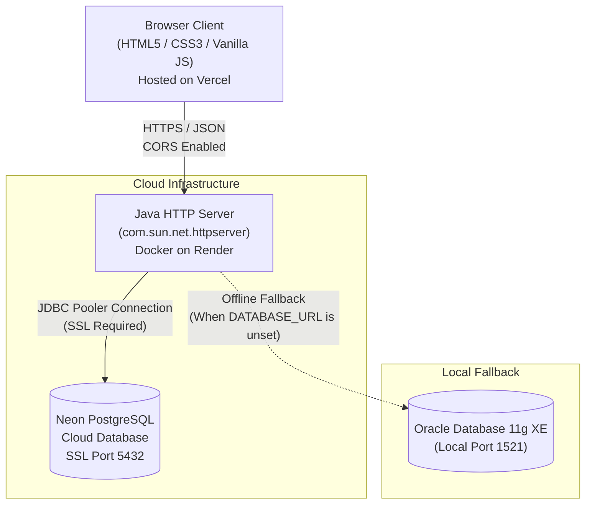

# ConstructPro — Construction Management & Site Analytics System

ConstructPro is a full-stack database-driven construction management system developed for academic DBMS laboratory coursework and portfolio presentation. It provides site engineers and project managers with a unified web interface to monitor ongoing construction projects, track milestone progress, analyze schedule adherence, calculate civil engineering resource estimates, and manage persistent relational records.

---

## Live Demo

| Component | Platform | URL |
| :--- | :--- | :--- |
| **Frontend Web Application** | Vercel | [https://constructpro-web.vercel.app](https://constructpro-web.vercel.app) |
| **Backend REST Service** | Render | [https://constructpro-cysp.onrender.com/projects](https://constructpro-cysp.onrender.com/projects) |

---

## Problem Statement

Civil engineering firms and construction contractors frequently manage multiple concurrent sites across diverse geographic regions. Tracking these operations using fragmented spreadsheets or manual logs presents significant challenges:

1. **Information Fragmentation**: Details regarding site locations, appointed project managers, and milestone progress percentages often become siloed, leading to communication gaps.
2. **Schedule Slippage**: Projects experience milestone delays without early visibility into execution velocity or schedule variance against target timelines.
3. **Inconsistent Estimation**: Preliminary budgeting, manpower sizing, and core material requirements (steel and cement) often depend on ad-hoc estimations rather than standardized formula models.
4. **Data Concurrency & Integrity**: Lacking a centralized relational database with domain constraints, records are susceptible to conflicting values, invalid progress percentages, and untracked status transitions.

ConstructPro addresses these issues by delivering a centralized, relational database system paired with a lightweight web interface for data entry, status auditing, velocity analysis, and material estimation.

---

## Key Features

- **Project Inventory Management**: Complete CRUD operations (Create, Read, Update, Delete) for construction project records directly bound to relational database transactions.
- **Progress & Lifecycle Tracking**: Real-time monitoring of project completion percentages (0–100%) and operational states (`PLANNING`, `ACTIVE`, `COMPLETED`).
- **Global Multi-Attribute Search**: Real-time client-side search across all project fields (Project ID, Name, Location, Manager, Progress %, and Status). Features immediate table re-rendering as you type, matching row counters (`Showing X of Y projects`), clear (`×`) controls, and custom no-match states.
- **Portfolio Summary Metrics**: Real-time aggregated KPI metric cards displaying ongoing site counts, total portfolio count, completed milestones, and portfolio-wide average progress.
- **Schedule Pace & Delay Risk Evaluator**: Deterministic pace evaluation engine that calculates daily velocity from elapsed days against target timelines, determines schedule variance, categorizes risk (`ON TRACK`, `DELAY RISK`, `CRITICAL DELAY`), and provides an option to sync progress and status directly back to the database.
- **Construction Feasibility & Material Estimator**: Formula-based estimation engine calculating projected expenditure, labor workforce requirements, structural steel tonnage, and cement volume based on square footage, project type (`Residential`, `Commercial`, `Industrial`), and construction quality grade (`Standard`, `Premium`, `Luxury`).
- **Estimation History Persistence**: Capability to save evaluated feasibility estimates into a dedicated relational table (`PROJECT_ESTIMATIONS`) for auditing.
- **Resilient Connection Recovery**: Built-in connection pooler recovery that transparently detects idle disconnects from serverless databases and re-establishes connectivity without dropping user requests.

---

## Technology Stack

| Layer | Technologies | Role / Purpose |
| :--- | :--- | :--- |
| **Frontend** | HTML5, CSS3, Vanilla JavaScript (ES6+) | Single-Page Application (SPA) dashboard, real-time search, form validation, dynamic DOM rendering, and API communication |
| **Backend** | Java 17 (Temurin OpenJDK) | Built-in `com.sun.net.httpserver.HttpServer`, REST endpoints, JSON payload construction, and CORS preflight handling |
| **Database** | PostgreSQL (Neon Cloud) / Oracle 11g XE | Relational data persistence, domain constraints, transactions, and schema management |
| **Database Driver** | PostgreSQL JDBC Driver (`42.7.3`) | Secure JDBC communication with cloud SSL connection poolers |
| **Hosting & DevOps** | Render (Docker), Vercel, Git, GitHub | Containerized backend deployment, static frontend hosting, and version control |

---

## System Architecture

ConstructPro uses a decoupled client-server architecture designed for reliability, fast load times, and minimal overhead.



- **Client Layer (Vercel)**: Serves static assets globally with minimal latency. Client logic makes asynchronous `fetch()` requests to the backend API.
- **Application Layer (Render)**: A containerized Java service running without heavy external frameworks. It handles routing, parameter parsing, business logic, CORS policies, and connection validation.
- **Data Layer (Neon)**: Serverless cloud PostgreSQL storing projects and historical estimations, secured with TLS and authenticated via role credentials.

---

## Database Design

The relational database schema is structured into two core tables designed to enforce domain-level data integrity:

```mermaid
erDiagram
    PROJECTS {
        varchar(10) PROJECT_ID PK
        varchar(100) PROJECT_NAME
        varchar(50) LOCATION
        varchar(50) MANAGER
        int PROGRESS "CHECK: 0 to 100"
        varchar(20) STATUS "CHECK: ACTIVE, COMPLETED, PLANNING"
    }

    PROJECT_ESTIMATIONS {
        varchar(20) EST_ID PK
        varchar(100) PROJECT_NAME
        varchar(30) PROJECT_TYPE
        varchar(20) QUALITY_GRADE
        numeric(10,2) AREA_SQFT
        numeric(14,2) ALLOCATED_BUDGET
        numeric(14,2) ESTIMATED_COST
        int REQUIRED_WORKERS
        numeric(8,2) STEEL_TONS
        int CEMENT_BAGS
        varchar(20) FEASIBILITY_STATUS
        timestamp CREATED_AT
    }
```

### Table 1: `PROJECTS`
Stores the active master inventory of construction projects.

| Column | Data Type | Constraints | Description |
| :--- | :--- | :--- | :--- |
| `PROJECT_ID` | `VARCHAR(10)` | `PRIMARY KEY` | Unique project identifier (e.g., `P001`) |
| `PROJECT_NAME` | `VARCHAR(100)` | `NOT NULL` | Descriptive name of the construction site |
| `LOCATION` | `VARCHAR(50)` | `NOT NULL` | City or region where work is being conducted |
| `MANAGER` | `VARCHAR(50)` | `NOT NULL` | Designated lead site engineer or project manager |
| `PROGRESS` | `INT` | `CHECK (PROGRESS BETWEEN 0 AND 100)` | Milestone completion percentage |
| `STATUS` | `VARCHAR(20)` | `CHECK (STATUS IN ('ACTIVE', 'COMPLETED', 'PLANNING'))` | Current operational state |

### Table 2: `PROJECT_ESTIMATIONS`
Maintains an audit log of civil engineering cost and feasibility assessments generated through the estimator engine.

| Column | Data Type | Constraints | Description |
| :--- | :--- | :--- | :--- |
| `EST_ID` | `VARCHAR(20)` | `PRIMARY KEY` | Unique estimation identifier (e.g., `EST123456`) |
| `PROJECT_NAME` | `VARCHAR(100)` | `NOT NULL` | Target project name evaluated |
| `PROJECT_TYPE` | `VARCHAR(30)` | `NOT NULL` | Classification: `Residential`, `Commercial`, `Industrial` |
| `QUALITY_GRADE` | `VARCHAR(20)` | `NOT NULL` | Specification tier: `Standard`, `Premium`, `Luxury` |
| `AREA_SQFT` | `NUMERIC(10,2)` | `NOT NULL` | Total planned gross construction area |
| `ALLOCATED_BUDGET`| `NUMERIC(14,2)` | `NOT NULL` | Financial budget allocated for the development |
| `ESTIMATED_COST` | `NUMERIC(14,2)` | `NOT NULL` | Calculated expenditure from rate models |
| `REQUIRED_WORKERS`| `INT` | — | Estimated manpower headcount required |
| `STEEL_TONS` | `NUMERIC(8,2)` | — | Calculated reinforcement steel requirements |
| `CEMENT_BAGS` | `INT` | — | Calculated cement quantity in standard 50kg bags |
| `FEASIBILITY_STATUS`| `VARCHAR(20)` | — | Outcome assessment: `FEASIBLE` or `BUDGET DEFICIT` |
| `CREATED_AT` | `TIMESTAMP` | `DEFAULT CURRENT_TIMESTAMP` | Timestamp when assessment was saved |

---

## API Reference

The backend exposes lightweight HTTP endpoints. All responses return `application/json` along with CORS headers (`Access-Control-Allow-Origin: *`). Preflight `OPTIONS` requests return `HTTP 204 No Content`.

| Endpoint | Method | Key Parameters | Functionality |
| :--- | :--- | :--- | :--- |
| `/projects` | `GET` | *None* | Returns JSON array of all projects in the `PROJECTS` table. |
| `/insert` | `GET` | `id`, `name`, `location`, `manager`, `progress`, `status` | Executes SQL `INSERT` to register a new project. |
| `/update` | `GET` | `id`, `name`, `location`, `manager`, `progress`, `status` | Executes SQL `UPDATE` for the project matching `id`. |
| `/delete` | `GET` | `id` | Executes SQL `DELETE` for the specified `id`. |
| `/evaluate` | `GET` | `id`, `progress`, `daysElapsed`, `targetDays`, `autoUpdate` | Calculates schedule pace and risk; commits progress and status if `autoUpdate=true`. |
| `/estimate` | `GET` | `name`, `type`, `grade`, `area`, `budget`, `save` | Computes costs, labor, and materials; inserts into `PROJECT_ESTIMATIONS` if `save=true`. |
| `/estimations`| `GET` | *None* | Returns saved estimation records ordered by `CREATED_AT DESC`. |

---

## Project Structure

```text
ConstructPro/
├── .dockerignore                  # Files excluded from Docker container builds
├── .env.example                   # Environment variable template for local setup
├── .gitignore                     # Git ignore rules (protects credentials and binaries)
├── Dockerfile                     # Multi-stage Docker build for Java 17 on Render
├── LICENSE                        # MIT License
├── README.md                      # Project documentation and submission reference
├── backend/
│   ├── Main.java                  # Java HTTP server, routing, JDBC operations, and CORS
│   ├── db.properties.example      # Template for local database credentials
│   └── postgresql-42.7.3.jar      # Official PostgreSQL JDBC driver
├── database/
│   ├── schema.sql                 # Oracle DDL & DML script for DBMS lab evaluation
│   └── schema_postgres.sql        # PostgreSQL DDL and idempotent seed scripts for Neon
└── frontend/
    ├── dashboard.html             # Main dashboard UI (inventory, search, evaluator, estimator)
    ├── index.html                 # Login page
    ├── script.js                  # Client logic, live search, calculations, and API routing
    └── style.css                  # Custom styling, dark palette, and responsive layouts
```

---

## Setup & Local Execution (Windows PowerShell)

### Prerequisites
- Java Development Kit (JDK 17 or higher)
- Python 3 (or Node.js) for serving static frontend files
- Git

### 1. Clone Repository
```powershell
git clone https://github.com/shettydakshraj/ConstructPro.git
cd ConstructPro
```

### 2. Configure Database Environment
To connect the local backend to your cloud Neon PostgreSQL instance, set the `DATABASE_URL` environment variable for your PowerShell session:

```powershell
$env:DATABASE_URL="postgresql://<username>:<password>@<neon-hostname>/<database>?sslmode=require"
```

Alternatively, copy `backend\db.properties.example` to `backend\db.properties` and add your connection string. *(This file is strictly git-ignored).*

### 3. Compile and Run Backend
```powershell
cd backend
javac -cp "postgresql-42.7.3.jar" Main.java
java -cp ".;postgresql-42.7.3.jar" Main
```
The terminal will confirm:
```text
Connecting to Cloud Database...
DATABASE CONNECTED SUCCESSFULLY!
SERVER RUNNING AT http://localhost:8081
```

*(Note: If `DATABASE_URL` is omitted, the backend automatically falls back to local Oracle Database 11g XE on `localhost:1521:XE` using `ojdbc6.jar`).*

### 4. Serve Frontend
Open a separate PowerShell window in the repository root:
```powershell
cd frontend
python -m http.server 3000
```
Open **`http://localhost:3000`** in your browser.

- When opened locally on `localhost` or via `file://`, `frontend/script.js` automatically routes API calls to `http://localhost:8081`.
- In production, it routes requests to `https://constructpro-cysp.onrender.com`.
- You can toggle the backend target anytime via the browser console:
  ```javascript
  setBackendUrl("http://localhost:8081");              // Target local backend
  setBackendUrl("https://constructpro-cysp.onrender.com"); // Target production backend
  ```

### Verified Login Credentials
For laboratory demonstration, client authentication is verified in `frontend/script.js`:
- **Username**: `admin`
- **Password**: `admin123`

---

## Deployment Summary

- **Backend (Render)**: Deployed as a Docker Web Service referencing the root `Dockerfile` (with root directory left blank). The `DATABASE_URL` secret is configured under Render's Environment Variables.
- **Frontend (Vercel)**: Deployed as a static website with the root directory set to `frontend` and framework preset `Other`.
- **Automated CI/CD**: Pushing commits to the `main` branch triggers automatic rebuilds on both platforms.

---

## Security & System Limitations

### Security Practices
- **Zero Committed Secrets**: No database passwords, private keys, or API credentials exist in the source repository.
- **Environment Isolation**: Production credentials are fed exclusively via runtime environment variables.
- **Strict `.gitignore` Enforcement**: Excludes `.env`, `*.pem`, `*.key`, and `backend/db.properties`.

### Current System Limitations
1. **Demonstration Authentication**: User validation is handled client-side in `script.js` to simplify laboratory demonstration. A production enterprise deployment would require server-side JWT or session token validation.
2. **Independent Table Design**: The `PROJECTS` and `PROJECT_ESTIMATIONS` tables currently operate without relational foreign key constraints to allow standalone estimation exercises independent of active projects.
3. **Free-Tier Cold Starts**: The backend is hosted on Render's free tier, which suspends containers after 15 minutes of inactivity. The initial request after idle periods may take ~30–45 seconds while the container boots.

---

## License

This project is open-source and available under the [MIT License](LICENSE).

### Demo Login

- **Username:** `admin`
- **Password:** `admin123`

## Author

**Developed by:** Dakshraj M Shetty  
**Project:** ConstructPro – Construction Management System  

This project was designed and developed as a full-stack construction management application using Java, JDBC, PostgreSQL, HTML, CSS, and JavaScript.